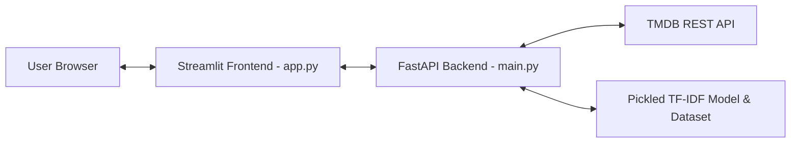

# 🎬 CineMatch — Movie Recommendation System

A full-stack, content-based movie recommendation system powered by **Machine Learning (TF-IDF & Cosine Similarity)**, a high-performance **FastAPI** backend, live metadata from **The Movie Database (TMDB) API**, and a modern **Streamlit** web user interface.

---

## ✨ Features

- **🧠 Machine Learning Recommendations**: Uses TF-IDF vectorization and cosine similarity over movie overviews and metadata to find contextually similar films.
- **⚡ FastAPI Backend**: Asynchronous REST API providing high-speed endpoints for search, movie details, home feeds, and recommendations.
- **🎨 Interactive Streamlit UI**:
  - Live search with instant keyword suggestions & poster grid.
  - Curated home feeds: *Trending*, *Popular*, *Top Rated*, *Now Playing*, and *Upcoming*.
  - Comprehensive movie details view: HD posters, backdrop banners, release date, genres, and overviews.
  - Hybrid recommendation sections: **TF-IDF content-based similarity** + **Genre-based discover recommendations**.
- **🌐 Cloud-Ready**: Pre-configured with `runtime.txt`, `.python-version`, and `requirements.txt` for one-click deployment on platforms like Render and Streamlit Community Cloud.

---

## 🏗️ Architecture



---

## 📁 Project Structure

```text
Movie_Recommend/
│
├── app.py                  # Streamlit frontend web application
├── main.py                 # FastAPI backend server with ML & TMDB endpoints
│
├── df.pkl                  # Processed movies DataFrame (Pickle)
├── tfidf.pkl               # Trained TfidfVectorizer model (Pickle)
├── tfidf_matrix.pkl        # Pre-computed TF-IDF feature matrix (Pickle)
├── indices.pkl             # Movie title-to-index lookup mapping (Pickle)
│
├── movies_metadata.csv     # Raw/Source movie metadata dataset
├── requirements.txt        # Python package dependencies
├── runtime.txt             # Python runtime specification for cloud deployment
├── .python-version         # Python version marker (3.11.9)
├── .env                    # Environment variables (TMDB API key)
└── README.md               # Project documentation
```

---

## 🚀 Getting Started

### 1. Prerequisites
- **Python 3.10 to 3.12** recommended.
- A free **TMDB API Key** from [The Movie Database](https://www.themoviedb.org/).

---

### 2. Clone the Repository

```bash
git clone https://github.com/Santhipriya-09/Movie-recommendations.git
cd Movie-recommendations
```

---

### 3. Set Up Virtual Environment

**Windows (PowerShell):**
```powershell
python -m venv .venv
.\.venv\Scripts\Activate.ps1
```

**macOS / Linux:**
```bash
python3 -m venv .venv
source .venv/bin/activate
```

---

### 4. Install Dependencies

```bash
pip install -r requirements.txt
```

---

### 5. Configure Environment Variables

Create a `.env` file in the root directory:

```env
TMDB_API_KEY=your_tmdb_api_key_here
```

---

## 🏃 Running the Application

You will run the backend and the frontend in **two separate terminal windows**:

### Terminal 1: Start the FastAPI Backend
```powershell
uvicorn main:app --reload --port 8000
```
- **Backend API:** `http://127.0.0.1:8000`
- **Interactive Swagger Docs:** `http://127.0.0.1:8000/docs`

### Terminal 2: Start the Streamlit Frontend
```powershell
streamlit run app.py
```
- **Web App:** `http://localhost:8501`

---

## 📡 API Reference

| Method | Endpoint | Description |
|---|---|---|
| `GET` | `/health` | Health check endpoint |
| `GET` | `/home?category=popular&limit=24` | Home feed (`trending`, `popular`, `top_rated`, `now_playing`, `upcoming`) |
| `GET` | `/tmdb/search?query=batman` | Live keyword search across TMDB catalog |
| `GET` | `/movie/id/{tmdb_id}` | Fetch full details, backdrop, genres, and overview for a movie |
| `GET` | `/recommend/genre?tmdb_id={id}` | Discover popular movies sharing the same primary genre |
| `GET` | `/recommend/tfidf?title={title}` | Raw TF-IDF cosine similarity recommendations from local dataset |
| `GET` | `/movie/search?query={title}` | Comprehensive bundle: movie details + TF-IDF recs + genre recs |

---

## 🛠️ Built With

- **[FastAPI](https://fastapi.tiangolo.com/)** — Asynchronous web framework for Python
- **[Streamlit](https://streamlit.io/)** — Fast web UI framework for data apps
- **[Scikit-Learn](https://scikit-learn.org/)** — TF-IDF Vectorizer & Cosine Similarity
- **[Pandas](https://pandas.pydata.org/)** & **[NumPy](https://numpy.org/)** — Data manipulation & linear algebra
- **[HTTPX](https://www.python-httpx.org/)** & **[Requests](https://requests.readthedocs.io/)** — Async and sync HTTP requests
- **[TMDB API](https://developer.themoviedb.org/docs)** — Movie metadata, posters, and imagery

---

## 👩‍💻 Author

**Santhipriya**  
- GitHub: [@Santhipriya-09](https://github.com/Santhipriya-09)

